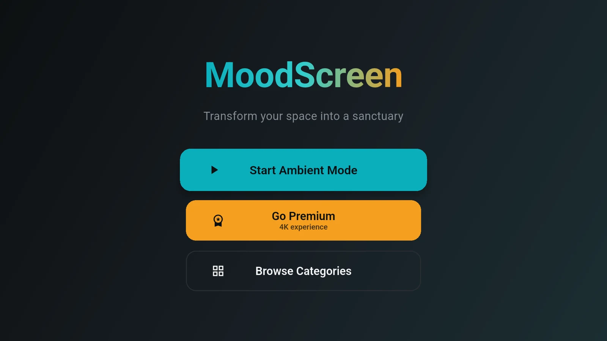
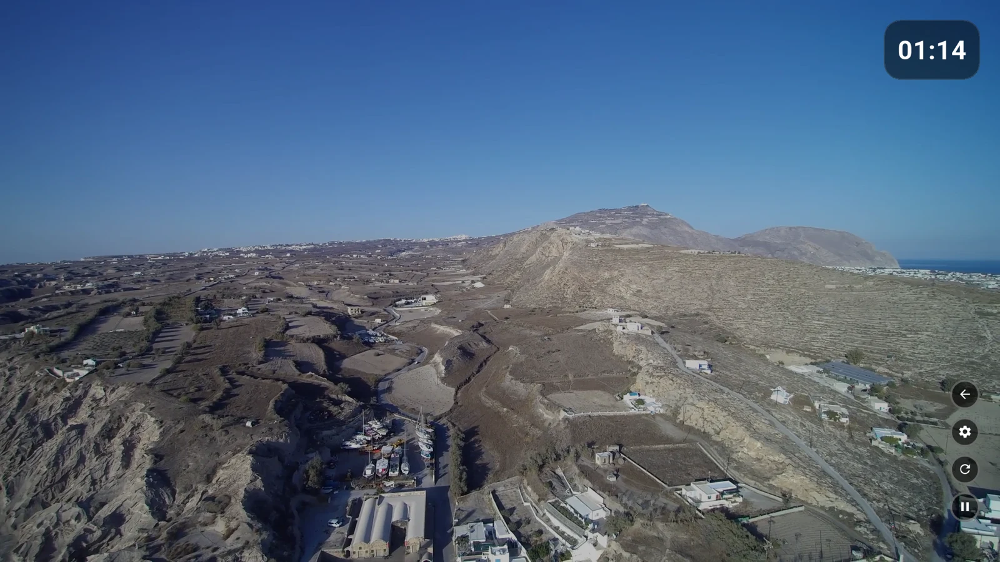
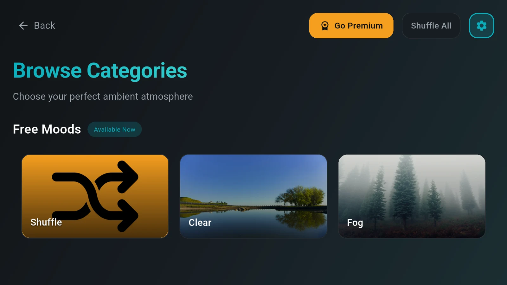
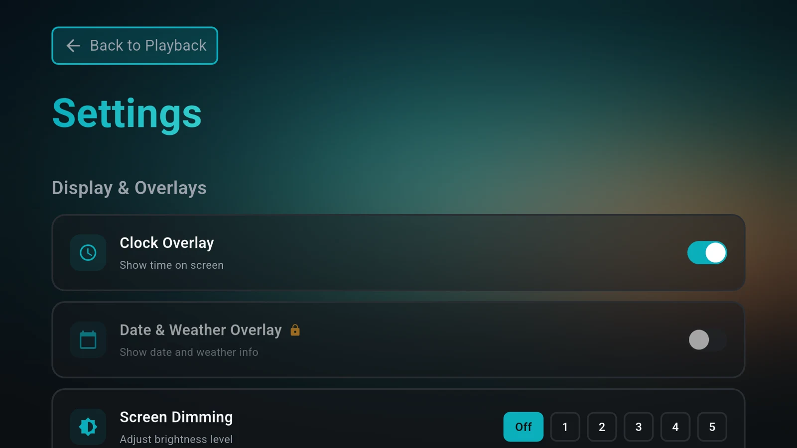
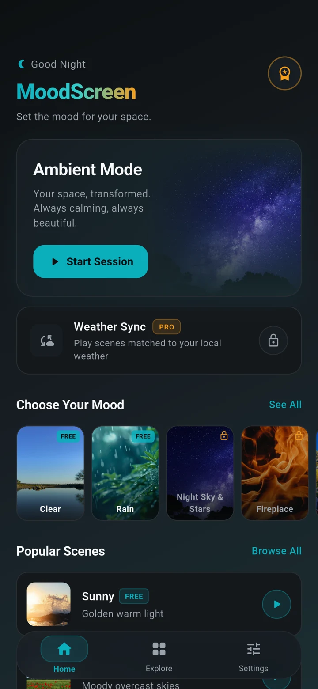
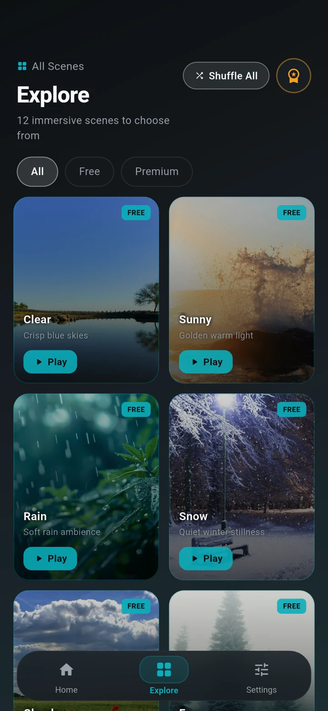
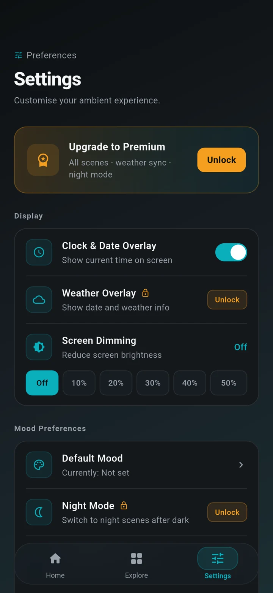
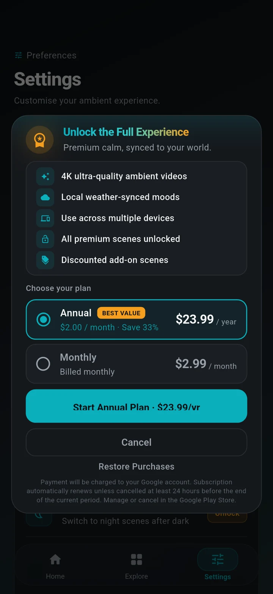
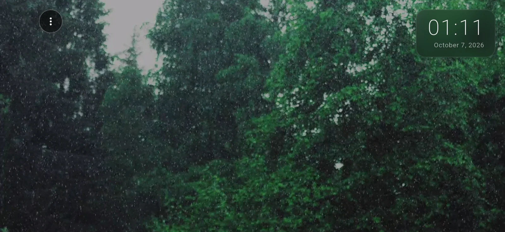

# Mood Screen

**An ambient video app that turns a phone or an Android TV into a calm, living display: curated looping scenes, optional weather-matched moods, a clock overlay and screen dimming.**

**Android TV and Android phone** (the mobile project also contains an iOS target) 
Flutter · Dart · Riverpod · Kotlin native bridges

<table>
  <tr>
    <td></td>
    <td></td>
  </tr>
</table>
Real screenshots from the Android TV build running on the Android TV (1080p) emulator.

---

## Product at a Glance

| | |
|---|---|
| **What it is** | Ambient scene player: looping nature, weather and sky videos for relaxing, background display or sleep |
| **Platforms** | Two Flutter projects: an Android TV app (leanback, D-pad focus navigation) and a phone app (Android, with an iOS target in the project) |
| **Content** | Free day and night weather scenes plus premium scenes (night sky, moon phases, nature, galaxy, fireplace, marine life), streamed from a curated Pexels video catalogue |
| **Weather sync** | Optional: picks scenes from current local weather and day or night |
| **Display** | Clock and date overlay, optional weather overlay, screen dimming, keep-awake during playback |
| **Monetisation** | Subscription and one-time scene packs, plus temporary unlock by watching a rewarded ad |
| **TV extras** | Android screensaver (Daydream) entry point that launches the player |
| **Code size** | About 16.8k lines of Dart (phone), 18.7k (TV), 1.5k lines of Kotlin across both |
| **Status** | Not publicly released. Documented here as a case study with screenshots from emulator builds |

## Product Showcase

### Android TV

<table>
  <tr>
    <td align="center"> <b>Browse categories</b> Focus-driven tiles, D-pad navigation</td>
    <td align="center"> <b>Settings</b> Overlays and dimming</td>
  </tr>
</table>

### Phone

<table>
  <tr>
    <td align="center"> <b>Home</b> Session, weather sync, moods</td>
    <td align="center"> <b>Explore</b> Scene grid with filters</td>
    <td align="center"> <b>Settings</b> Overlay, dimming, defaults</td>
    <td align="center"> <b>Premium</b> Plan selection dialog</td>
  </tr>
</table>

   
  <b>Player (landscape)</b> — rain scene with clock and date overlay

Phone screenshots come from the Android build on a Pixel 4a emulator. Free-tier state, no purchases.

## Key Features

- **Curated ambient scenes**: 12 scenes on the phone Explore screen (Clear, Sunny, Cloudy, Rain, Snow, Fog, Night Sky and Stars, Moon Phases, Nature, Galaxy Drift, Fireplace, Marine Life); six are free, six premium.
- **Weather sync**: reads current weather for an IP-derived or manually set location and maps conditions to a scene category, with separate day and night sets.
- **Shuffle or manual**: shuffle across all, free-only or premium-only scenes, or play one chosen scene.
- **Adaptive quality**: resolution tiers from 720p to 4K chosen from measured network speed and a native 4K hardware-decode check.
- **Overlays and comfort**: clock and date overlay, weather overlay, screen dimming levels, keep-awake while playing.
- **First-run setup flow**: location source, weather model and night-mode screens before the player.
- **Offline-tolerant start**: a bundled fallback video plays immediately while the real videos download; downloads are cached on device.
- **Premium model**: subscription (monthly or annual), one-time scene packs, and a temporary unlock via rewarded ad.
- **Android TV**: leanback launcher entry, banner, focus-based navigation on every screen, and a Daydream screensaver service.

## Engineering Highlights

### Instant first frame, deferred initialisation
`main()` runs a splash-only app with no awaits; plugins, preferences, ads and analytics start after the first frame. This keeps cold start responsive even when platform channels are slow.

### Video pipeline built for flaky networks
A priority download queue writes to a temp file and renames atomically, caps retained videos globally, and never deletes the fallback clip. Playback measures network speed, picks a resolution tier, and warns on slow connections.

### Native capability checks
A Kotlin method channel reports whether the device can hardware-decode 4K HEVC and returns decoder-fallback preferences, so weak TV boxes are not given streams they cannot play.

### One product, two targets
The phone and TV projects share the same domain code (weather categories, video catalogue, settings state) but diverge in navigation (tab shell versus D-pad focus screens), ads (AdMob versus Unity Ads) and backend wiring (Firebase on TV).

## Architecture

Flutter UI over Riverpod state and a services layer (weather, Pexels, download and cache, preferences, billing), with Kotlin code for billing, 4K probing, keep-awake and the TV screensaver. See [docs/ARCHITECTURE.md](docs/ARCHITECTURE.md).

## Technology Stack

| Layer | Technology |
|---|---|
| UI and state | Flutter, Dart 3.9, Riverpod |
| Playback | `video_player` with a native decoder-config bridge |
| Content and weather | Pexels video API (curated IDs), WeatherAPI, IP geolocation |
| Storage | `shared_preferences`, files in app storage |
| Billing | `in_app_purchase` plus a Kotlin purchase bridge |
| Ads | Google AdMob (phone), Unity Ads (TV) |
| Backend (TV build) | Firebase Core, Auth, Firestore, Analytics, Crashlytics, Google Sign-In |
| Native | Kotlin (Android), Swift app delegate (iOS target) |

## Documentation

- [Product overview](docs/PRODUCT_OVERVIEW.md)
- [Technical case study](docs/TECHNICAL_CASE_STUDY.md)
- [Architecture](docs/ARCHITECTURE.md)
- [Engineering challenges](docs/ENGINEERING_CHALLENGES.md)
- [Privacy and source](docs/PRIVACY_AND_SOURCE.md)

## Source Code

The production source is private and not included. See [RIGHTS.md](RIGHTS.md).
