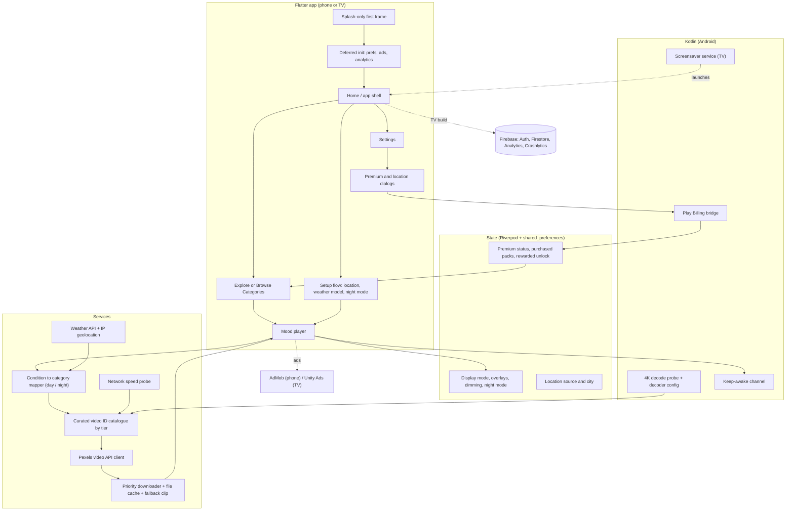

# Architecture

## Notes

- The player owns video lifecycle, overlays, ad scheduling and recovery timers (stuck video, offline retry, slow internet).
- Navigation: phone uses a tab shell plus named routes (`/home`, `/locationSource`, `/weatherModel`, `/nightMode`, `/experience`, `/moodPlayer`, `/settings`); TV uses the same routes with focus-driven screens.
- Firebase is wired only in the TV build; the phone build compiles it out with a feature flag.
- Secrets (API keys) are loaded from a bundled env file at runtime. Sensitive configuration exists and is excluded from this repository.
